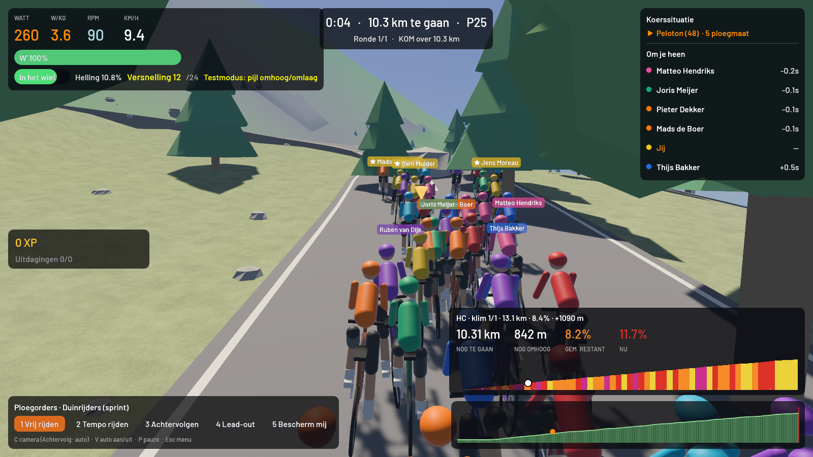
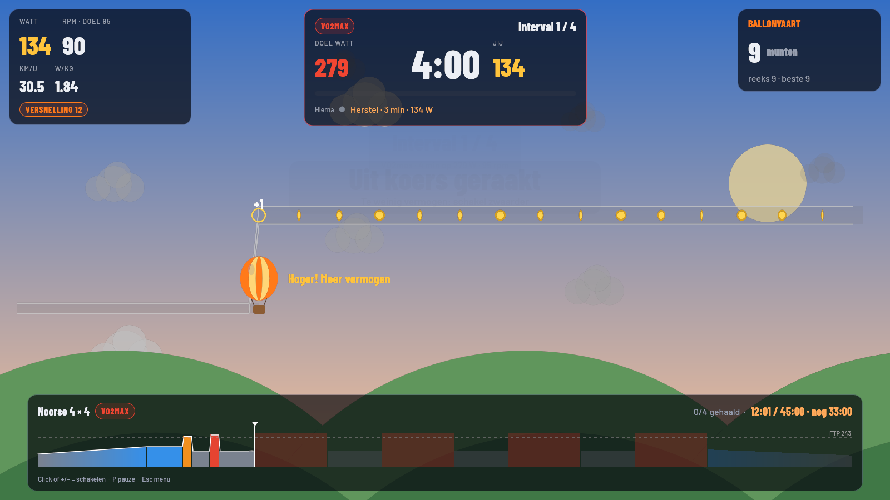
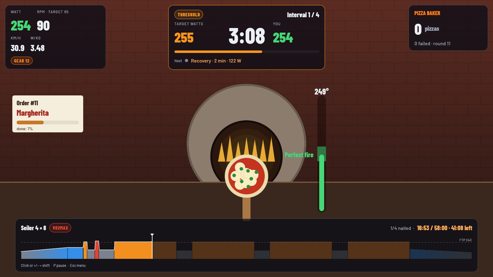
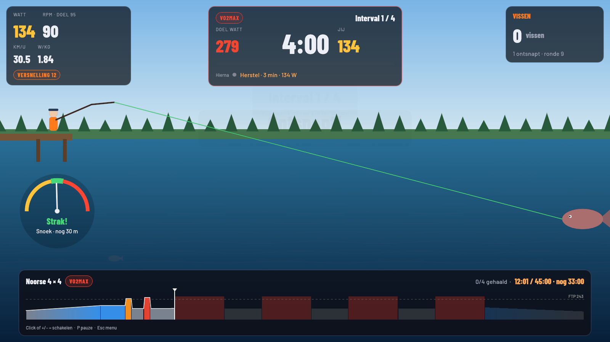
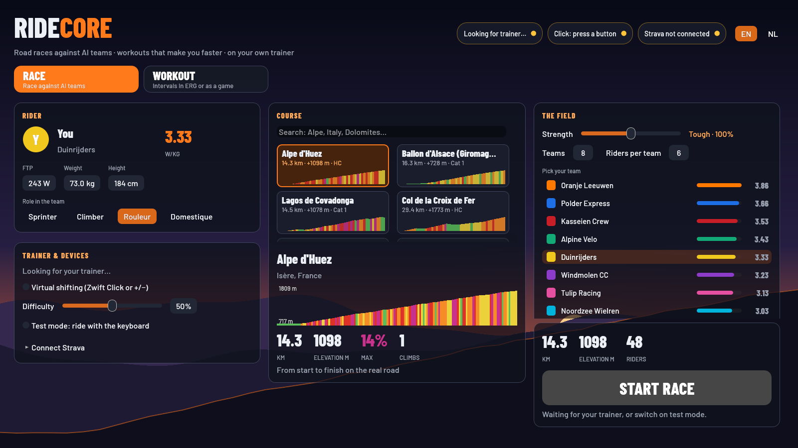

# RideCore

**Road races against AI teams, structured workouts and workout mini-games, on your own smart trainer.**
A free, open-source indoor cycling app written in Rust with [Bevy](https://bevyengine.org).



> RideCore speaks **English** and **Dutch**. It starts in your system's language; switch with the EN/NL buttons at the top right of the start screen.

## What it does

- **Races against AI teams** on 20 real climbs and routes: Alpe d'Huez, Mont Ventoux, Stelvio, the finale of Liège–Bastogne–Liège and more. The routes are built from OpenStreetMap roads and real elevation data. The race has a full peloton with drafting, attacks and team orders, and you pick your role: sprinter, climber, rouleur or domestique.
- **Watch a race.** No trainer needed: *Watch this race* on the start screen lets the AI ride the whole race while you follow any rider. Pick one from the race order or step through it with the arrow keys and Tab. The quiet stretches fast-forward and the attacks and the finale play at real speed.
- **Workouts in ERG mode.** A library of proven sessions (Rønnestad 30/15, Seiler 4×8, Norwegian 4×4, sweet spot, threshold, a ramp test that sets your FTP), with a live timeline, coaching and a summary at the end.
- **Build your own workouts.** Stack blocks (steady, ramp, intervals, free ride) in watts or % FTP, with a live profile, duration, TSS, IF and NP as you go. Ready-made parts (warm-up, 4 × 4, 30/15s, sweet spot…), one-click zones, undo, and any library workout can be copied and tweaked. Export to Zwift's `.zwo` format, or drop a `.zwo` file on the window to import it.
- **Workout games.** Instead of staring at a watt number you can ride any workout as a game. Your power against the target is the controller:
  - **Balloon ride**: your power is your altitude. Stay in the corridor and collect the coins.
  - **Pizza baker**: your power is the fire. Every round is a pizza: don't serve it raw, don't burn it.
  - **Fishing**: your power is the tension on the line. Too slack and the fish swims away.

  Games run without ERG. The trainer rides a flat road and you hit the target with your gears, so it's you holding the watts, not the trainer.
- **Virtual shifting** with a Zwift Click (or the +/− keys). On trainers that support Zwift's own trainer protocol, like the Wahoo KICKR CORE with the Zwift Cog, RideCore sends the grade and gear ratio to the trainer and lets it set the resistance itself, the way Zwift does. Shifts land instantly. Other trainers use a standard FTMS fallback.
- **FIT files and Strava upload.** Every ride and workout is saved as a `.fit` file in `~/Documents/RideCore`. You can also upload it to Strava using your own Strava API app. Its credentials are stored only in the macOS Keychain.

| Balloon ride | Pizza baker | Fishing |
|---|---|---|
|  |  |  |



## Hardware

- A smart trainer with Bluetooth **FTMS** (Fitness Machine Service). It has been tested on a Wahoo KICKR CORE with the Zwift Cog.
- Optional: a **Zwift Click** for shifting, and a Bluetooth heart-rate strap.
- No trainer? Switch on *Test mode* to ride with the keyboard.

RideCore is developed and tested on **macOS** (Apple Silicon). Bevy and btleplug are cross-platform, so Linux and Windows may work, but they haven't been tested yet. Reports and fixes are welcome.

## Running it

You need a recent [Rust toolchain](https://rustup.rs) (edition 2024).

```sh
git clone https://github.com/TymovanRijn/ridecore.git
cd ridecore
cargo run --release --bin race
```

The first build takes a while. macOS will ask for Bluetooth permission the first time RideCore runs.

On macOS, `tools/make_app.sh` puts a `RideCore.app` on your Desktop. Opening it rebuilds RideCore from this folder when the code has changed, then starts it.

### Handy extras

- `cargo run --release --bin trainer_probe`: lists what your trainer offers over Bluetooth, without changing the resistance.
- `cargo run --release --bin click_probe`: shows the button presses and battery level of a Zwift Click.
- `RIDECORE_LANG=en` or `RIDECORE_LANG=nl`: forces the language.
- `RIDECORE_DEBUG=1`: logs raw Bluetooth traffic. Each ride also writes a trainer log to `~/Library/Logs/RideCore-trainer.csv`.
- `cargo run --release --example race_lab`: races the AI riders against each other a few hundred times, about 13,000× faster than real time, and checks the results against real road racing (bunch sprints on flat courses, climbers on summit finishes, how often riders attack). Run it after changing the race AI.
- `cargo run --release --example race_story flat-loop 4 7 even`: tells one of those races minute by minute, to see why it went the way it did.

## Project layout

```
src/            core library: Bluetooth (FTMS, Zwift Click and trainer protocol),
                trainer control, physics, routes, workouts, FIT, Strava
src/race/       the race simulation: physics in the bunch, drafting, AI tactics
src/bin/race/   the game: 3D world, rider models, HUD, training mode and games
examples/       the race lab and race story tools
assets/         routes, map data and fonts (embedded in the binary at build time)
tools/          scripts that build the routes, the map data and the macOS app
```

## Credits and data

- Map and road data © [OpenStreetMap](https://www.openstreetmap.org/copyright) contributors, available under the ODbL.
- Elevation: EU-DEM v1.1 © European Union, Copernicus. Terrain tiles by Mapzen/Tilezen on AWS Open Data.
- Fonts: Lilita One © Juan Montoreano and Varela Round © The Varela Round Project Authors, both under the SIL Open Font License (`assets/fonts/OFL-*.txt`).
- The Zwift Click and trainer message formats were documented by the open-source projects [incyclist/devices](https://github.com/incyclist/devices) and [qdomyos-zwift](https://github.com/cagnulein/qdomyos-zwift).

RideCore is an independent hobby project. It is **not affiliated with, endorsed by or connected to Zwift, Wahoo or Strava**. Product names are used only to describe compatibility.

## License

GPL-3.0-or-later: you may use, change and share RideCore freely, as long as what you share stays open source under the same license. See [LICENSE](LICENSE).
